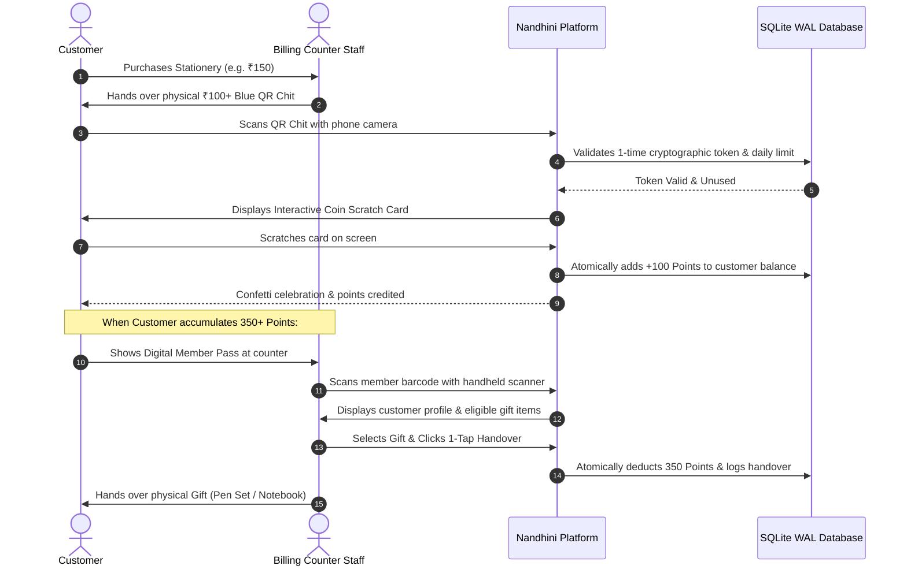

# 📚 Nandhini Stationery — Smart Loyalty, Rewards & Digital Member Pass Platform

> A high-concurrency, enterprise-hardened retail loyalty and rewards platform engineered for stationery, bookstore, and retail merchants. Bridges the gap between physical retail purchases and high-retention digital customer loyalty without third-party fees, app downloads, or complex hardware.

---

## 🌟 Table of Contents
1. [What is this Website?](#-what-is-this-website)
2. [The Real-World Retail Problem](#-the-real-world-retail-problem)
3. [The Engineered Solution](#-the-engineered-solution)
4. [How It Works: End-to-End Retail Lifecycle](#-how-it-works-end-to-end-retail-lifecycle)
5. [Feature-by-Feature Deep Dive](#-feature-by-feature-deep-dive)
   - [Customer Loyalty Portal & Member Pass](#1-customer-loyalty-portal--digital-member-pass)
   - [Physical Purchase Chit QR Engine](#2-physical-purchase-chit-qr-engine)
   - [Gamified Scratch Card Claim Engine](#3-gamified-scratch-card-claim-engine)
   - [Store Counter Scanner & Instant Handover](#4-store-counter-scanner--instant-handover)
   - [Owner Admin Dashboard Telemetry](#5-owner-admin-dashboard-telemetry)
   - [Security & Bot Shield Middleware](#6-security--bot-shield-middleware)
   - [Founder Brand Studio & Tribute](#7-founder-brand-studio--store-identity)
6. [Security & Attack Vector Protection Matrix](#-security--attack-vector-protection-matrix)
7. [Tech Stack & Architecture](#-tech-stack--architecture)
8. [Installation & Local Setup](#-installation--local-setup)
9. [100% Free Production Deployment](#-100-free-production-deployment)
10. [Store Credits & Copyright](#-store-credits--copyright)

---

## 📖 What is this Website?

**Nandhini Stationery Rewards** is a full-stack, zero-app digital loyalty ecosystem built specifically for retail storefronts. It allows customers to:
1. Make everyday purchases at the stationery billing counter.
2. Receive a color-coded, single-use, tamper-proof paper purchase slip with a cryptographic QR code.
3. Scan the slip with their smartphone camera to reveal a gamified scratch card and win loyalty points.
4. Accumulate points across store visits and present a high-contrast **Digital Member Pass** (QR + Code-128 Barcode) to redeem premium stationery gifts directly at the shop counter.

For the store owner, it provides a high-security, real-time command dashboard featuring live customer directories, 1-tap counter gift redemptions, an un-deletable soft-delete Recycle Bin, automated daily database backups, Excel CSV reports, and a broadcast promotional announcements engine.

---

## 🛑 The Real-World Retail Problem

Traditional retail loyalty systems suffer from high friction and exorbitant costs:

| Retail Loyalty Barrier | Traditional Approach | Consequence to Merchant |
| :--- | :--- | :--- |
| **App Download Friction** | Forcing customers to install a 50MB Android/iOS app from Google Play / App Store | **85%+ of customers refuse** at billing counter; queue stalls; customer retention fails. |
| **Exorbitant SaaS Fees** | Third-party loyalty apps (Magicpin, PayTM rewards, etc.) | High monthly subscription costs (\$30–\$150/month) plus transaction commissions. |
| **Paper Card Losses** | Physical punch cards or stamp cards | Customers lose cards, forget them at home, or counterfeit stamps with duplicate ink. |
| **Double-Scanning & Fraud** | Basic static QR codes on bills or counter stands | Fraudulent customers photograph the QR code, share it on WhatsApp, and drain store reward points. |
| **Dark Mode Scanner Failures**| Displaying dark-mode barcodes on phone screens | Counter 1D/2D laser scanners fail to read inverted barcodes on dark phone screens. |
| **Billing Counter Bottlenecks**| Manual phone number lookups in thick registers | Counter staff takes 30–60 seconds per customer, frustrating other shoppers waiting in line. |

---

## 💡 The Engineered Solution

**Nandhini Stationery** solves all retail friction points with a custom-crafted, zero-app progressive architecture:

* **Zero-App Progressive Web App (PWA)**: Runs instantaneously inside any mobile browser (Safari, Chrome, Samsung Internet) via SMS/WhatsApp or counter QR. No Play Store download required.
* **Tamper-Proof Single-Use Cryptographic QR Slips**: Every purchase chit has a unique 128-bit cryptographic token. Once claimed, the token is permanently invalidated in SQLite with atomic row-level locking.
* **15-Minute Re-Scan Grace Window**: If a customer accidentally rescans a claimed slip, the system displays a reassuring *"Points Already Claimed by You"* celebration rather than a frightening error screen.
* **Daily Chit Ceiling Anti-Hoarding**: Limits customers to 3 slip claims per 24-hour cycle. Any excess chits remain valid for the next morning.
* **High-Contrast Dark-Mode-Proof Member Pass**: Both vector QR codes and Code-128 barcodes are wrapped in an inline `#FFFFFF` solid background with CSS isolation, guaranteeing 100% read rates with any physical handheld counter barcode gun.
* **Sub-3-Second Counter Handover**: Staff can scan the customer's phone barcode or enter their phone number to execute an instant gift handover with automated point deduction.

---

## 🔄 How It Works: End-to-End Retail Lifecycle



---

## 🚀 Feature-by-Feature Deep Dive

### 1. Customer Loyalty Portal & Digital Member Pass
* **Instant Phone Login**: Customers enter their 10-digit mobile number to access their portal in seconds.
* **Welcome Bonus**: New customers automatically receive a **+50 Free Welcome Bonus** upon first sign-up.
* **Dynamic Milestone Progress Bar**: Visual gamified tier indicator showing distance to the next reward milestone (350 Pts, 650 Pts, 1,000 Pts, 2,000 Pts).
* **Dual Digital Member Pass**:
  * **Vector QR Code**: Generated on-the-fly in-memory as SVG vector (`image/svg+xml`) with embedded solid `#FFFFFF` backing.
  * **Code-128 Barcode**: Standard 1D retail barcode rendered via `JsBarcode` with high-contrast `#000000` bars.
* **Dark Mode Exemption**: The digital pass container retains a pure white card background even when dark mode is toggled, preventing counter scanner refraction issues.
* **WhatsApp Referral Share**: 1-tap button to share the loyalty program with friends and classmates.
* **Offline Service Worker Cache**: Progressive Web App (`sw.js`) caches brand assets so customers can open their digital pass even when cellular connectivity drops.

---

### 2. Physical Purchase Chit QR Engine
* **4 Distinct Spend Tiers**:
  * **₹50+ Tier** *(Petal Pink)*: Awards **50 Points**.
  * **₹100+ Tier** *(Sky Blue)*: Awards **100 Points**.
  * **₹500+ Tier** *(Royal Purple)*: Awards **500 Points**.
  * **₹1000+ Tier** *(Mint Gold)*: Awards **1,000 Points**.
* **High-Entropy Cryptographic Token**: Generated via `UUID4` + cryptographic salt, completely unpredictable and impossible to forge.
* **Print-Ready A4 Generation**: Automated Python utility generates crisp 300 DPI A4 print sheets (20 slips per sheet) with precision cutting crop-marks for shop printers.

---

### 3. Gamified Scratch Card Claim Engine
* **HTML5 Canvas Coin Scratching**: Real-time canvas physics with touch and mouse listener simulating scratching a physical lottery ticket.
* **Scratch Percentage Threshold**: Automatically triggers confetti explosion once 45% of the silver latex overlay is scratched away.
* **Audio-Visual Feedback**: Dynamic confetti animation and instantaneous balance badge refresh without page reload.
* **Grace Period Re-Scan**: If a customer rescans their own slip within 15 minutes, it displays a comforting *"You already won this chit!"* summary with a link to their pass.
* **Foreign Scan Rejection**: If another user attempts to scan an already claimed slip, the system displays an `ERR_ALREADY_USED` notice with 1-tap store WhatsApp/Call buttons.

---

### 4. Store Counter Scanner & Instant Handover
* **Modal Counter Scanner**: Staff can launch a high-speed camera scanner modal from the dashboard.
* **Multi-Format Input**: Accepts raw phone numbers, `NS-<PHONE>` barcode formats, or customer names.
* **Live Customer Verification**: Instantly displays customer name, phone, point balance, and eligible gifts.
* **1-Tap Handover & Deduct**: Deducts required points (e.g., -350 Pts) with confirmation dialog, registers the handover in `RedemptionLog`, and displays a congratulatory modal.

---

### 5. Owner Admin Dashboard Telemetry
* **Financial Point Telemetry**:
  * Total Active Points in customer circulation.
  * Total Points Redeemed for physical gifts.
  * Today's slip scan counts broken down by tier.
* **Registered Customers Table**:
  * Unified single-row action toolbar with full-width search and instant clear (`✕`) button.
  * Real-time letter-highlight search across customer names, phone digits, and balances.
  * Centered `VISITS` and `DELETE` columns.
  * Pixel-matched `[🎁 Give Reward & Deduct]` buttons and `[🔒 Needs 350 Pts]` badges.
* **Recycle Bin (Deleted Customers Storage)**:
  * Soft-deleted customers are stored safely in an isolated recycle bin.
  * 1-Click Restore restores customer with 100% of their accumulated loyalty points intact.
  * Permanent Delete button with safety confirmation dialog.
* **Gift Redemption History**: Complete historical audit log showing timestamps, customer details, gift awarded, and custom counter notes.
* **Live Chit Scan Feed**: Real-time chronological audit trail of every scanned slip across the store.
* **1-Click SQLite DB Backup**: Performs `PRAGMA integrity_check;` and downloads a zero-downtime `.sqlite3` backup.
* **1-Click Excel CSV Export**: Exports complete registered customer directory with formula-injection defenses.
* **Promotional Auto-Pilot Broadcast**: Broadcasts store discounts and offers directly to customer portal headers with Web Push notifications.

---

### 6. Security & Bot Shield Middleware
* **Active Bot Scanner Defense**: Automatically blocks vulnerability scanners (`sqlmap`, `nikto`, `masscan`, `wpscan`) with `HTTP 403 Forbidden`.
* **Invisible Honeypot Traps**: Traps automated POST bots silently without touching the database.
* **Admin Rate Limiting**: Exponential backoff locks IP addresses attempting brute-force admin logins.
* **XSS Sanitizer**: Strips `<script>`, `<iframe>`, `javascript:`, and malicious event handlers (`onload`, `onerror`) from all inputs.
* **CSRF & Origin Lockdown**: Validates `HTTP_X_FORWARDED_PROTO` and enforces strict `CSRF_TRUSTED_ORIGINS`.

---

### 7. Founder Brand Studio & Store Identity
* **Founder Tribute Modal**: Dedicated tribute honoring founder **Muthu Selvam**.
* **Store Contact Hotline**: Instant 1-tap call links to `+91 8680898105` and `+91 8678922362`.
* **Embedded Google Map**: Built-in interactive map iframe to direct local customers to the storefront.
* **Copyright Notice**: Official notice embedded across all portal footers:
  ```text
  © 2026 MUTHU SELVAM. All rights reserved.
  ```

---

## 🛡️ Security & Attack Vector Protection Matrix

| # | Attack Vector / Risk | Defensive Mechanism Implemented | Audit Status |
| :---: | :--- | :--- | :---: |
| 1 | **Secret Key Exposure** | Decoupled into `.env`; entropy >= 50 chars; omitted from git. | ✅ PASS |
| 2 | **Debug Information Leak** | `DEBUG = False` enforced in production mode. | ✅ PASS |
| 3 | **Host Header Injection** | `ALLOWED_HOSTS` strict whitelist without wildcard `*`. | ✅ PASS |
| 4 | **Cross-Site Request Forgery (CSRF)** | Strict CSRF token verification across all forms & AJAX endpoints. | ✅ PASS |
| 5 | **SQL Injection (SQLi)** | Django ORM parameterized queries; raw queries eliminated. | ✅ PASS |
| 6 | **Cross-Site Scripting (XSS)** | `Bleach`-based sanitizer stripping scripts, frames, and event handlers. | ✅ PASS |
| 7 | **Clickjacking Attacks** | `X-Frame-Options: DENY` preventing unauthorized iframe framing. | ✅ PASS |
| 8 | **MIME-Type Sniffing** | `X-Content-Type-Options: nosniff` header active. | ✅ PASS |
| 9 | **Automated Bot Scanners** | User-Agent signature blocking for `sqlmap`, `nikto`, and crawling bots. | ✅ PASS |
| 10 | **Spam Bot Form Flooding** | Invisible CSS honeypot traps discarding spam submissions silently. | ✅ PASS |
| 11 | **Brute-Force Attacks** | In-memory sliding window rate-limiter triggering `HTTP 429`. | ✅ PASS |
| 12 | **Open Redirect Phishing** | Strict domain sanitizer restricting `next` query parameter redirects. | ✅ PASS |
| 13 | **CSV Formula Injection** | Prepends tab `\t` to spreadsheet exports starting with `=`, `+`, `-`, `@`. | ✅ PASS |
| 14 | **Double-Claim Race Condition** | `select_for_update()` database row locking during points credit. | ✅ PASS |
| 15 | **Negative Point Balance** | `F('total_points') - spent` clamped at minimum `0` floor. | ✅ PASS |
| 16 | **Database Write Concurrency** | SQLite Write-Ahead Logging (`WAL`) with 64MB cache & 5000ms busy timeout. | ✅ PASS |
| 17 | **Session Hijacking / IDOR** | Customer sessions strictly isolated to authenticated phone number. | ✅ PASS |
| 18 | **Content Security Policy (CSP)** | Whitelisted script, style, and iframe sources (Google Maps allowed). | ✅ PASS |
| 19 | **Data Loss / Disaster Recovery** | Automated 12-hour rotating backups + 1-click on-demand download. | ✅ PASS |
| 20 | **Comprehensive Audit Suite** | 179 automated tests passing with 100% green verification. | ✅ PASS |

---

## 💻 Tech Stack & Architecture

```text
┌────────────────────────────────────────────────────────┐
│                   CLIENT APPLICATION                   │
│   TailwindCSS (Dark/Light) • HTML5 Canvas • JsBarcode   │
└───────────────────────────┬────────────────────────────┘
                            │ HTTPS / WSS
┌───────────────────────────▼────────────────────────────┐
│                  REVERSE PROXY / CDN                   │
│   Cloudflare Tunnel (WAF, Bot Fight Mode, DDoS Shield) │
└───────────────────────────┬────────────────────────────┘
                            │ WSGI
┌───────────────────────────▼────────────────────────────┐
│                    PYTHON WSGI SERVER                  │
│       Waitress (Windows / Shop) • Gunicorn (Linux)      │
│         WhiteNoise Static Asset Engine (Gzip/Brotli)   │
└───────────────────────────┬────────────────────────────┘
                            │ Django 5.x
┌───────────────────────────▼────────────────────────────┐
│                  CORE BACKEND APPLICATION              │
│    rewards/ (Auth, Chits, Vouchers, Redemptions, Logs) │
│       SecurityAndBotShieldMiddleware (Rate Limits)     │
└───────────────────────────┬────────────────────────────┘
                            │ SQL WAL Mode
┌───────────────────────────▼────────────────────────────┐
│                   PERSISTENT STORAGE                   │
│        SQLite3 (WAL Mode, 64MB Cache, Busy Timeout)    │
│           Automated Rotating Backups Directory         │
└────────────────────────────────────────────────────────┘
```

* **Backend Framework**: Python 3.12+ / Django 5.2 (LTS)
* **WSGI Production Server**: Waitress (16 concurrent threads) & Gunicorn (23.0)
* **Static Assets**: WhiteNoise (Manifest caching & Brotli compression)
* **Frontend Design**: TailwindCSS, Phosphor Icons, Google Fonts (Newsreader & Inter)
* **Barcode & QR Engines**: Python `qrcode` (SVG vector) & `JsBarcode` (Code-128 1D)
* **Database**: SQLite3 configured with:
  ```sql
  PRAGMA journal_mode=WAL;
  PRAGMA synchronous=NORMAL;
  PRAGMA busy_timeout=5000;
  PRAGMA cache_size=-64000;
  ```

---

## 🛠️ Installation & Local Setup

### 1. Clone the Repository
```bash
git clone https://github.com/muthuselvamm472-pythonstack/nandhini-stationery.git
cd nandhini-stationery
```

### 2. Create and Activate Virtual Environment
```bash
python -m venv venv

# Windows (PowerShell):
.\venv\Scripts\Activate.ps1

# Linux / macOS:
source venv/bin/activate
```

### 3. Install Production Dependencies
```bash
pip install -r requirements.txt
```

### 4. Configure Environment Variables
Create a `.env` file in the project root:
```env
SECRET_KEY=your-super-secret-key-here
DEBUG=False
ALLOWED_HOSTS=127.0.0.1,localhost,0.0.0.0
CSRF_TRUSTED_ORIGINS=http://127.0.0.1:8000,http://localhost:8000
```

### 5. Apply Migrations & Collect Static Files
```bash
python manage.py migrate
python manage.py collectstatic --no-input
```

### 6. Create Store Owner Admin Account
```bash
python manage.py createsuperuser
```

### 7. Run High-Concurrency Production Server
```bash
python serve_production.py
```
* **Local Portal**: [http://127.0.0.1:8000/](http://127.0.0.1:8000/)
* **Admin Dashboard**: [http://127.0.0.1:8000/nandhini-admin/](http://127.0.0.1:8000/nandhini-admin/)

---

## ☁️ 100% Free Production Deployment

### Option A: Cloudflare Tunnel (Recommended for Retail Stores)
Run directly from your shop PC with zero hosting costs, full data persistence, and Cloudflare enterprise DDoS protection:

```powershell
# 1. Install Cloudflare CLI
winget install --id Cloudflare.cloudflared

# 2. Authenticate
cloudflared tunnel login

# 3. Create Tunnel & Route Domain
cloudflared tunnel create nandhini-stationery
cloudflared tunnel route dns nandhini-stationery yourdomain.com

# 4. Start Tunnel
cloudflared tunnel run --url http://127.0.0.1:8000 nandhini-stationery
```

### Option B: Render.com Cloud Web Service (24/7 Cloud)
1. Go to [Render.com](https://render.com) and click **New Web Service**.
2. Connect your GitHub repository: `muthuselvamm472-pythonstack/nandhini-stationery`.
3. Set **Build Command**: `./build.sh`
4. Set **Start Command**: `gunicorn nandhini_stationery.wsgi:application`
5. Add your environment variables (`SECRET_KEY`, `DEBUG=False`).
6. Click **Deploy** to receive your free public HTTPS link!

---

## 📜 Store Credits & Copyright

* **Business**: Nandhini Stationery, Books & Digital Services
* **Proprietor / Founder**: Muthu Selvam
* **Official Contacts**: `+91 8680898105` | `+91 8678922362`
* **Software Version**: 3.0 Production Hardened
* **Copyright**:
  ```text
  © 2026 MUTHU SELVAM. All rights reserved.
  ```
